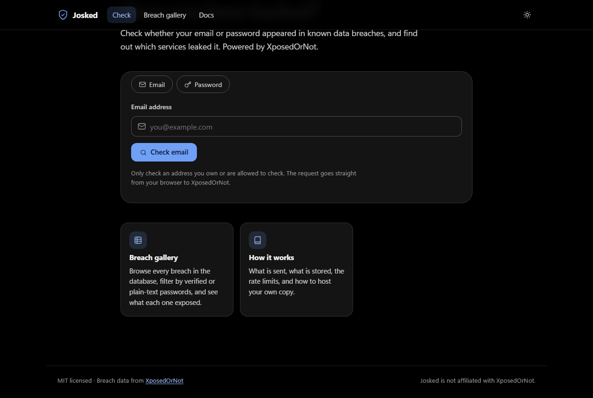
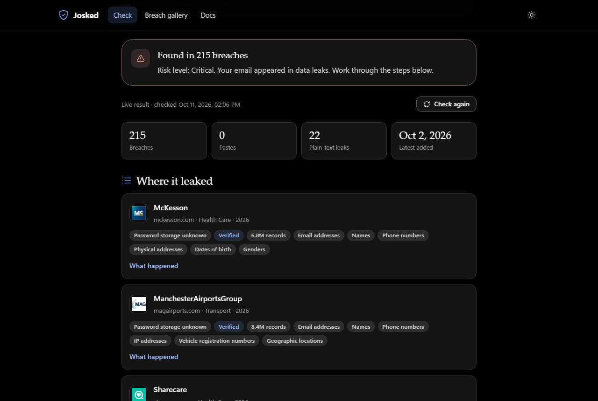
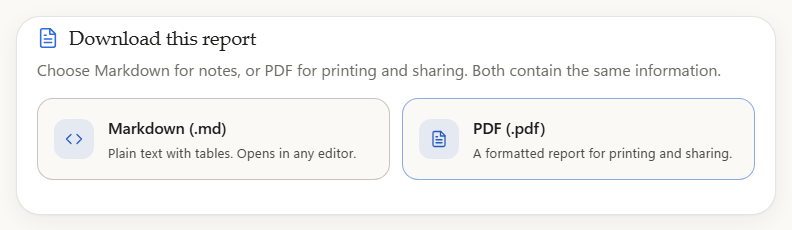
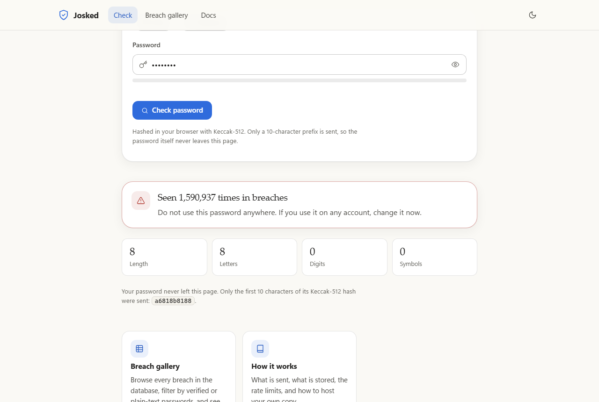
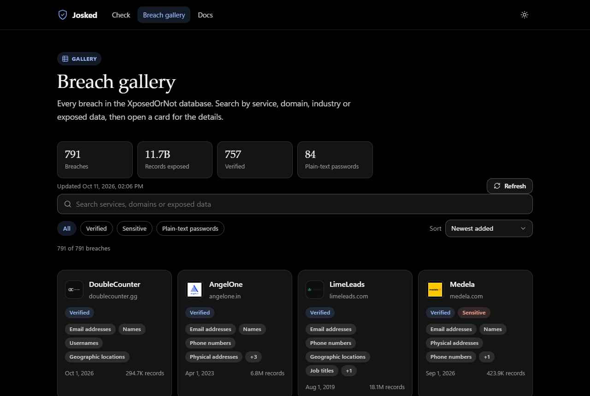
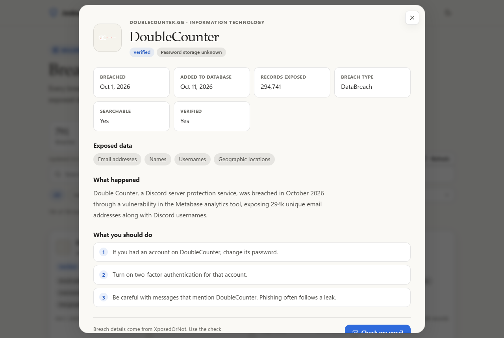
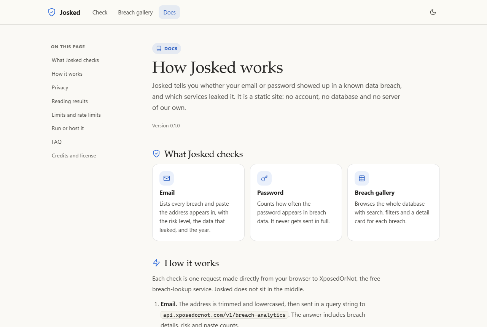
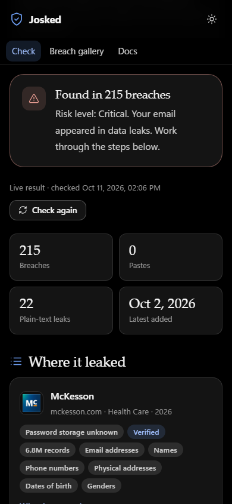

<p align="center">
  
</p>

<h1 align="center">Josked</h1>

<p align="center">
  <b>Have you been hacked? Check your email and passwords in seconds.</b><br>
  Finds the data breaches your email or password appeared in, and tells you which services leaked them.<br>
  Free, no account, no backend. Your password never leaves your browser.
</p>

<p align="center">
  <a href="LICENSE"></a>
  
  
  
  
</p>

<p align="center">
  <a href="#quick-start">Quick start</a> &middot;
  <a href="#features">Features</a> &middot;
  <a href="#reports">Reports</a> &middot;
  <a href="#screenshots">Screenshots</a> &middot;
  <a href="#how-it-works">How it works</a> &middot;
  <a href="#privacy">Privacy</a> &middot;
  <a href="#limits">Limits</a> &middot;
  <a href="public/docs.html">Docs</a>
</p>

---

## What is Josked?

Josked answers one question: **has this email or password already leaked?** Breaches like these are how accounts get taken over, so knowing early lets you change the right passwords before someone else does.

- **Check an email.** See every breach it appears in, the risk level, the data that leaked (passwords, phone numbers, addresses...), and a checklist of what to do.
- **Check a password.** See how often it appears in breach data. The password is hashed in your browser, and only a 10-character prefix of the hash is sent.
- **Browse the breach gallery.** Every breach in the database, searchable and filterable, with a full write-up for each one.
- **Download a report.** Choose a Markdown file or a formatted PDF with the same results.

It is plain HTML, CSS and JavaScript. There is no build step and no npm package to install.

## Quick start

### Windows (easiest)

Double-click **start.bat** in the Josked folder. It starts the site and opens it in your browser. Keep its window open while you use the site.

You need [Node.js](https://nodejs.org) 18 or newer. The file tells you if it is missing.

### macOS and Linux

```bash
npm start
```

Then open <http://localhost:4173>.

### Without Node

Python also works:

```bash
python -m http.server 4173 --directory public
```

Opening `index.html` by double-clicking will not work, because browsers refuse ES modules from `file://`. Use one of the commands above.

### Host it for free

Upload the `public/` folder to any static host (GitHub Pages, Netlify, Cloudflare Pages, Vercel static). Nothing needs configuring.

## Features

| | Feature | What you can do |
|---|---|---|
|  | **Email check** | Lists every breach and paste that contains the address, with the year, the exposed data, password risk and a risk level from XposedOrNot. |
|  | **Password check** | Counts how often the password appears in breach data. Only a 10-character Keccak-512 prefix is sent. |
|  | **Live results** | Every check asks XposedOrNot directly. Use **Check again** for fresh data, and the gallery shows when its list was updated. |
|  | **Reports** | Download the result as a Markdown file or a formatted PDF, built in your browser. |
|  | **Breach gallery** | All breaches, with search, filters (verified, sensitive, plain-text passwords), sorting and a full write-up for each. |
|  | **What to do now** | Advice that changes with what was found: plain-text passwords, phone numbers, leaked session tokens. |
|  | **Private by design** | No account, no server of its own, no logs. A strict Content-Security-Policy limits what the page can load. |
|  | **Any device** | Phones, tablets and computers. Light and dark themes, following your system setting. |
|  | **Docs** | Explains the data flow, privacy, limits and how to host it. |

## Reports

On the email result, choose **Markdown (.md)** or **PDF (.pdf)**. Both files contain the same information: the verdict, the summary figures, a table of every breach, write-ups for the most recent breaches, and the checklist.

- **Markdown** is plain text with tables. Good for notes, tickets and version control.
- **PDF** is laid out for printing and sharing: a masthead, summary tiles, a striped table that repeats its header on every page, and page numbers.

Both are created in your browser. Nothing is uploaded.

Examples: [sample-report.pdf](docs/sample-report.pdf) and [sample-report.md](docs/sample-report.md), made from the live result for `test@example.com`.

## Screenshots

<table>
  <tr>
    <td width="50%"><p align="center">Check page (dark theme)</p></td>
    <td width="50%"><p align="center">Email result: breaches and the checklist</p></td>
  </tr>
  <tr>
    <td><p align="center">Choose Markdown or PDF</p></td>
    <td><p align="center">Password result: seen 1,590,937 times</p></td>
  </tr>
  <tr>
    <td><p align="center">Breach gallery</p></td>
    <td><p align="center">A breach write-up</p></td>
  </tr>
  <tr>
    <td><p align="center">Docs</p></td>
    <td align="center"><p align="center">On a phone</p></td>
  </tr>
</table>

## How it works

Every lookup goes straight from your browser to XposedOrNot. Josked has no server in between.

1. **Email:** `GET api.xposedornot.com/v1/breach-analytics?email=…`
2. **Password:** the browser computes Keccak-512 of the password, then `GET passwords.xposedornot.com/api/v1/pass/anon/{first 10 hex chars}`. The count comes back, and the password itself never leaves the page.
3. **Gallery:** `GET api.xposedornot.com/v1/breaches`, cached for 15 minutes per tab. **Refresh** loads the latest list at once.

The API sends `Access-Control-Allow-Origin: *`, so the browser can call it directly. The email address is in the query string of the email request, which is how that API works.

## Privacy

- **No Josked server, no database, no logs.** The site is static files.
- **Passwords stay in the page.** They are hashed locally. The prefix is the only part sent, and it cannot be used to recover the password.
- **Results stay in memory.** Email results are kept for 10 minutes in the page's memory and disappear when the tab closes.
- **Reports stay on your device.** The Markdown and PDF files are built in the browser.
- **No referrer.** The pages set a `no-referrer` referrer policy.
- **XposedOrNot still sees your request.** It gets the email or prefix and your IP address, like any API call.

Only check an address you own, or one you have permission to check.

## Limits

- **Rate limit:** requests are spaced about 1.1 seconds apart, matching XposedOrNot's free tier of about one request per second.
- **Data freshness:** email results are live when you check, and saved for 10 minutes to avoid repeat requests. **Check again** asks for new data. The gallery list is saved for 15 minutes, and **Refresh** loads it at once.
- **Upstream caps:** XposedOrNot can add hourly or daily limits to its free tier. Josked cannot lift those. If you see "limiting requests", wait a minute.
- **Coverage:** XposedOrNot only knows breaches it has collected. "Not found" does not mean the account is safe.
- **Not included:** domain-wide monitoring needs an XposedOrNot Plus API key, which must stay secret, so it is not in this static version.

## For developers

```bash
npm start              # serve public/ on http://localhost:4173
npm test               # parsing, rate limiting, password hashing and PDF generation tests
```

### Project layout

```text
Josked/
├── start.bat               Windows launcher (checks Node, starts the site, opens it)
├── server.mjs              Local static server (no dependencies)
├── package.json
├── public/                 The whole site. Deploy this folder.
│   ├── index.html          Check page (email, password, report download)
│   ├── breaches.html       Breach gallery and write-ups
│   ├── docs.html           Docs
│   ├── css/
│   │   ├── globals.css     Design tokens and base styles (from AlgoWorld)
│   │   ├── site.css        Site shell, prose, cards and tables (from AlgoWorld)
│   │   └── josked.css      Components specific to Josked
│   ├── js/
│   │   ├── core.js         Parsing, verdicts, advice and report model (no DOM, no network)
│   │   ├── report-pdf.js   PDF report layout (jsPDF)
│   │   ├── api.js          XposedOrNot calls, request spacing and caching
│   │   ├── check.js        Check page
│   │   ├── breaches.js     Gallery page
│   │   ├── docs.js         Docs page chrome
│   │   ├── common.js       Theme, icon sprite and formatting helpers
│   │   └── icons.js        Icon sprite (AlgoWorld icon set)
│   └── vendor/             Vendored MIT libraries (see Credits)
├── docs/                   README assets and sample reports
└── test/
    └── core.test.mjs       Unit tests (npm test)
```

## Credits

- **Breach data, logos and risk scores:** [XposedOrNot](https://xposedornot.com). API reference and SDK: [XposedOrNot-JS](https://github.com/XposedOrNot/XposedOrNot-JS).
- **Keccak-512:** [js-sha3](https://github.com/emn178/js-sha3) (MIT).
- **PDF reports:** [jsPDF](https://github.com/parallax/jsPDF) and [jsPDF-AutoTable](https://github.com/simonbengtsson/jsPDF-AutoTable) (MIT).
- **Look and feel:** the design tokens, layout, icon set and README structure come from AlgoWorld.

Josked is not affiliated with XposedOrNot.

## Contributing

Issues and pull requests are welcome. Keep the site static and free of build steps, and run `npm test` before you open a pull request.

## License

MIT. See [LICENSE](LICENSE).
